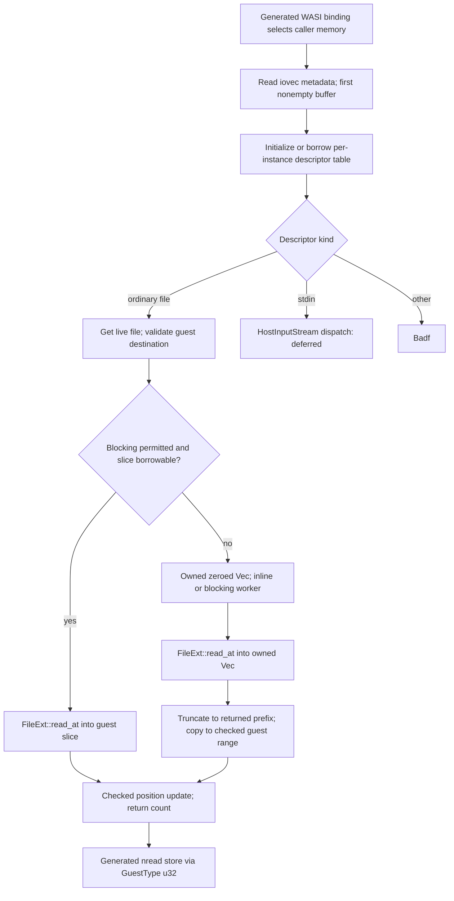

# fd_read: source map and proof obligations

Source baseline: Wasmtime `7f3dc0a6aed721b6f72a1cc5e6107a548d2bca17`.
The subsequent production memory port changes backend reads and byte copy-back
as described below. The machine-readable
[inventory](inventory.json) contains checked anchors, line numbers and normalized
source hashes. Rebuild with `python3 verification/flux/inventory.py`; verify
without changing it with `python3 verification/flux/inventory.py --check`.

This is an inspected partial effect graph. Its 46-export table is ABI accounting,
not 46 verified hostcalls or a complete transitive syscall graph.

## Guest and descriptor handling

The generated entry code in `crates/wiggle/generate/src/wasmtime.rs` obtains
the caller's `memory` export. The ordinary unshared branch constructs
`GuestMemory::Ranges`; shared memory is a separate branch outside the initial
profile. Proving the true allocation/instance binding is B01 in TRUST.md.

`first_non_empty_iovec` in `crates/wasi/src/p1.rs` traverses descriptors until it
finds one with nonzero `buf_len`, then returns that payload pointer. It checks
fuel and uses generated record-field loads. The record generator performs
field-offset pointer arithmetic; primitive guest loads use validated ranges,
alignment checks, and atomic/unsafe bridges. All those obligations remain open.

The array of descriptor metadata and the selected payload are different memory
regions and require separate checks. This path does not issue readv over every
guest entry. If all entries are empty, the selected range is `(0, 0)`; a zero
count is not automatically evidence that no OS operation occurs.

`transact()` may run `Descriptors::new` on first use. For the first conditional
ordinary-file slice, require an already initialized authorized descriptor table.
Lazy initialization is listed in the graph but its effects are unresolved. A
claim covering the first hostcall must discharge that additional branch.

Descriptor lookup then translates the guest fd into an instance-table entry,
borrows the component resource, and accesses its underlying file. A successful
lookup is not itself a proof of authorized provisioning or descriptor lifetime.

## Direct and worker branches

The file branch evaluates `memory.as_slice_mut(iov)?` while selecting between
direct and fallback execution, so destination validation occurs before the
ordinary-file worker read too.

- Direct: blocking is allowed and the guest memory can be borrowed. The backend
  reads directly into that guest slice.
- Fallback: drop any temporary guest slice, allocate a zero-filled Vec of the
  selected payload capacity, then call `File::run_blocking`. That helper either
  executes the closure immediately or spawns it; the closure owns the buffer.
  On success it truncates the buffer and the continuation copies the prefix
  back to the guest.

`Arc<File>` cloning and ownership are promising evidence for lifetime safety,
not a proof of it. `spawn_blocking` returns an abort-on-drop handle, but aborting
a handle is not sufficient to establish that an already running blocking task
has stopped. The future proof must establish that the worker owns everything
it may still use, and holds no escaping guest borrow.

`GuestMemory::copy_from_bytes` now validates length agreement and obtains the
unshared destination slice before delegating to the Flux-checked
`memory_policy::copy_bytes`. That consumer constructs a real-pointer write
permit and performs the actual bounded `ptr::copy`. Its source is a valid
initialized Rust byte slice. The GuestMemory method and incoming unsafe slice
bridge remain unproved. Shared memory falls back to the existing generic
`copy_from_slice` and is excluded. Zero-length copy still returns before
destination validation and has no copy effect. Scratch ownership across
suspension and complete copy-back composition remain B02/B06/B07.

## External boundary identified in pinned source

For compiler commit `1a2c4797ef2570bd76ca5dee34449169bc7dc457` on
`x86_64-unknown-linux-gnu`, the inspected chain is:

1. With `p1`, Wasmtime `filesystem/unix.rs::read_at_cursor_unspecified` now
   delegates through `wiggle::memory_policy::read_at`, a checked actual-slice
   permit wrapper. Its one trusted adapter calls `FileExt::read_at`.
2. The standard library's filesystem implementation delegates to `FileDesc`.
3. [`FileDesc::read_at`](https://github.com/rust-lang/rust/blob/1a2c4797ef2570bd76ca5dee34449169bc7dc457/library/std/src/sys/fd/unix.rs#L191)
   calls `libc::pread64(fd, destination, min(capacity, READ_LIMIT), offset)` and
   converts its result. The GNU/Linux import selects pread64 explicitly.

The C wrapper, deployed glibc and kernel implementation have not been verified
or pinned as executable artifacts. The repository's Cargo.lock libc version is
not a substitute for pinning the precompiled Rust standard library's internals.
This source trace identifies the boundary where a narrow contract belongs;
it does not constitute a proof of the syscall contract or its deployed binding.

The adapter's external contract requirements are:

- Descriptor is live and authorized under the context invariant.
- All possible destination writes fit the supplied writable allocation on
  every outcome, including errors. Use a conservative capacity footprint.
- A successful returned count lies between zero and the supplied capacity.
- Any source bytes subsequently read/copied are initialized.
- Other allocations and policy state are framed appropriately.

Pointer-capacity preconditions and success count are in its Flux signature.
Kernel write footprint/framing are documented semantic assumptions; the kernel
body is not checked. Descriptor authorization is not established by that
signature. No contract asserting the entire fd_read hostcall safe is introduced.

## Completion, errors, aliases and generated stores

After a read, `fd_read` checks position arithmetic and updates the stored
position. An overflow or later conversion error can occur after an OS effect
and a guest write. Do not model those errors as rollback.

The WASI result also requires a guest `nread` store. The inspected generator's
`Instruction::Store` emits `memory.write`, ultimately a u32 guest store.
The [actual expanded wrapper](evidence/fd-read/fd-read-glue.rs) and its
[checksum metadata](evidence/fd-read/evidence.json) were captured in the
[passing run](https://github.com/sji005/wasmtime/actions/runs/43993427124).
It writes `Size` through `arg3` in the `Ok` branch after the trait call. The
`Err` branch downcasts the error without that store. CI compares fresh expansion
to the saved wrapper checksum. These are source observations, not a Flux proof
of the wrapper. Its result pointer may be invalid or overlap earlier data/metadata. Reason from
the actual evaluation order rather than assuming disjointness or no prior
effects when the final store traps.

The stdin branch dispatches through a HostInputStream and copies returned
bytes back after checking its returned length. Custom stream effects have not
been resolved. The current ordinary-file scope does not cover all fd_read
descriptor kinds.

## Checked model versus next concrete gate

The model imports the production range helper and proves that abstract memory
effects with mismatched labels or invalid ranges cannot enter its safe trace.
It records a file-read write footprint and a same-guest read/write copy pair.
It executes neither operation and supplies no scratch-buffer proof.

The new [production port](MEMORY_ISOLATION.md) constructs permits from actual
borrowed slices and checks the real copy and bounded adapter calls. This is
separate from the abstract trace. The remaining gate is proving that these are
the correct calling guest's slices and composing every caller, error path,
metadata access and result store. Only the identified module nodes and arithmetic
helper are marked checked; the complete hostcall remains unproved.
